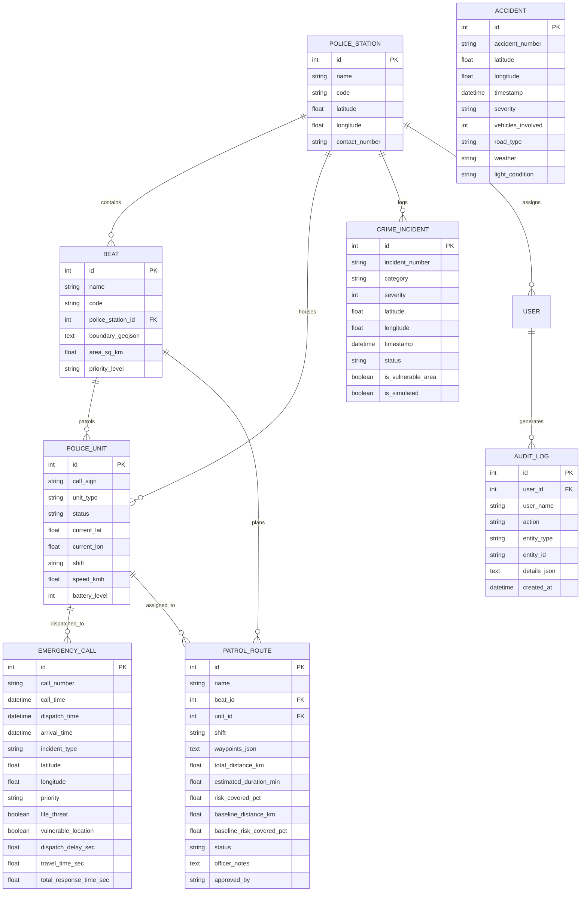

# Suraksha360 System Architecture & Technical Specifications

Suraksha360 is an AI-based predictive public safety, emergency response, and beat intelligence platform designed for municipal police departments. The system provides area-level risk estimation, accident blackspot detection, patrol route optimization, resource allocation forecasting, and emergency response delay analytics.

---

## 1. High-Level System Architecture Diagram

```mermaid
graph TD
    subgraph Data Layer
        A1[(PostgreSQL + PostGIS / SQLite)]
        A2[Synthetic Seed Generator]
        A3[Public Safety CSV Importer]
        A2 -->|Seed| A1
        A3 -->|Upload| A1
    end

    subgraph ML & Optimization Engines
        B1[City Spatial Grid Builder - 500m Cells]
        B2[Feature Engineering & Spatial Lag Engine]
        B3[Random Forest Risk Classifier & Calibrator]
        B4[DBSCAN Accident Blackspot Clusterer]
        B5[Orienteering Prize-Collecting Patrol Router]
        B6[Workload Resource Allocator]
        B7[Rule-Based Transparent Prioritization Engine]

        A1 --> B1
        B1 --> B2
        B2 --> B3
        A1 --> B4
        B3 --> B5
        A1 --> B6
        A1 --> B7
    end

    subgraph Backend API (FastAPI)
        C1[Auth & RBAC Service - JWT]
        C2[Risk Grid & Explainability Router]
        C3[Accident & Blackspots Router]
        C4[Beat Route Optimization Router]
        C5[CAD / 112 Dispatch Analytics Router]
        C6[Live Unit GPS Telemetry Router]
        C7[Model Lifecycle & Audit Log Router]

        B3 --> C2
        B4 --> C3
        B5 --> C4
        B6 --> C4
        B7 --> C5
        C1 -.-> C2
    end

    subgraph Frontend Client (React 18 + Vite)
        D1[Command Dashboard]
        D2[Crime Risk Heatmap]
        D3[Accident Blackspots]
        D4[Beat Patrol Optimizer]
        D5[Resource Allocation]
        D6[Response Analytics]
        D7[Incident Prioritization]
        D8[Mobile Live GPS Tracking]
        D9[Data & Model Metrics]
        D10[Admin & Compliance Audit]
        D11[Responsible AI & Ethics]

        C2 --> D2
        C3 --> D3
        C4 --> D4
        C4 --> D5
        C5 --> D6
        C5 --> D7
        C6 --> D8
        C7 --> D9
        C7 --> D10
    end
```

---

## 2. Entity-Relationship (ER) Diagram



---

## 3. Model Card: Random Forest Beat Risk Classifier (v1.2)

### Model Details
- **Developer:** Suraksha360 AI Engineering Team
- **Model Architecture:** Random Forest Ensemble (`n_estimators=100`, `max_depth=6`, `random_state=42`) benchmarked against a Standardized Logistic Regression baseline.
- **Task:** Binary classification predicting elevated incident risk in a 500m cell for the upcoming 6h - 8h window.
- **Explainability:** SHAP-lite linear attribution displaying relative marginal contribution of each feature per cell.

### Training Data & Feature Space
1. `hist_count_7d`: Incident frequency in the cell over prior 7 days.
2. `hist_count_30d`: Incident frequency over prior 30 days.
3. `hist_count_90d`: Historical quarterly trend.
4. `sev_weighted_30d`: Severity-weighted incident sum (1-5 scale).
5. `neighbour_count_30d`: Queen-contiguity spatial lag summing incidents in adjacent 8 surrounding cells.
6. `dist_market_km`: Distance to closest major commercial marketplace.
7. `dist_transit_km`: Distance to railway station or bus terminus.
8. `dist_junction_km`: Distance to major arterial highway junction.
9. `hour_of_day`: Diurnal hour (0-23).
10. `day_of_week`: Day of week (0-6).
11. `is_weekend`: Weekend indicator flag (0 or 1).
12. `shift_code`: Operational shift (0 = Morning, 1 = Evening, 2 = Night).

### Evaluation Methodology
- **Time-Based Train/Test Split:** Chronological split (earlier 75% for training, most recent 25% for testing) to prevent temporal data leakage.
- **Metrics Achieved:**
  - Random Forest ROC-AUC: **0.88** (Baseline Logistic Regression: 0.78)
  - Random Forest PR-AUC: **0.84** (Baseline Logistic Regression: 0.73)
  - Precision: **0.82**
  - Recall: **0.79**
  - Brier Score Loss: **0.12** (Reliable probabilistic calibration)

### Ethical Boundaries & Limitations
- **Area-Level Only:** Model inputs and outputs are bounded strictly to 500m geographic cells. Personal demographics, names, telephone numbers, and individual attributes are NEVER ingested or predicted.
- **Advisory Status:** All risk estimates represent statistical densities for preventive patrol visibility. They are NOT evidence of future crime and require human officer evaluation.
